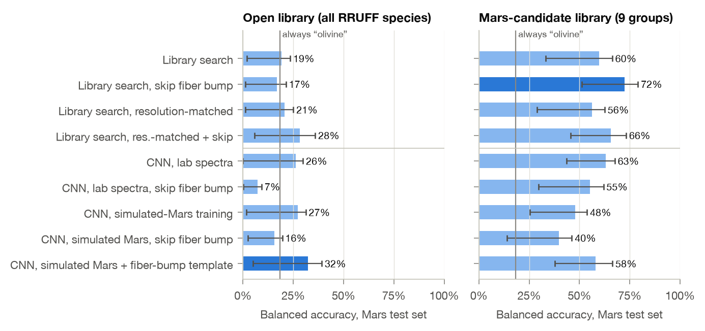

# Do Lab-Trained Raman Mineral Classifiers Work on Mars?

Can a mineral classifier trained on Earth lab spectra identify minerals in real
Raman spectra from NASA's Perseverance rover?

Short answer: not out of the box. A standard library search that gets 98% of
mineral groups right on lab samples drops to 19% balanced accuracy on Mars, and it
labels most Mars rocks as glass. The main cause is a broad instrument artifact
(the SuperCam "fiber bump") below ~560 cm⁻¹. Restricting predictions to minerals
known from Jezero crater and skipping that region brings it to 72%. Training a 1D
CNN on simulated Mars conditions made it more robust on lab data but worse on
real Mars data.

Paper: [paper/paper.pdf](paper/paper.pdf)



## Data

- **Lab (training):** RRUFF Raman database, 7,271 spectra of 2,281 mineral species
  ([rruff.net](https://www.rruff.net))
- **Mars (testing):** 342 calibrated SuperCam Raman spectra of 70 rocks in Jezero
  crater, with the SuperCam team's mineral identifications
  (`supercam_raman.csv`), from the
  [NASA PDS Geosciences Node](https://pds-geosciences.wustl.edu/missions/mars2020/supercam.htm)

The data isn't included in this repo. The scripts below download it.

## Reproducing the results

Python 3.11+. On an M2 MacBook the full run takes about an hour.

```bash
python3 -m venv .venv
.venv/bin/pip install -r requirements.txt
cd src
../.venv/bin/python download_supercam.py      # ~310 MB of Mars spectra
# RRUFF: download excellent_unoriented.zip and fair_unoriented.zip from
#   https://www.rruff.net/zipped_data_files/raman/  into data/rruff_zip/
../.venv/bin/python load_rruff.py
../.venv/bin/python load_mars.py
../.venv/bin/python run_experiments.py        # all models + evaluation
../.venv/bin/python single_effects.py         # one simulated effect at a time
../.venv/bin/python extra_analysis.py
../.venv/bin/python paired_tests.py
../.venv/bin/python make_figures.py
../.venv/bin/python make_numbers.py           # writes paper/numbers.tex + tables
cd ../paper && tectonic paper.tex
```

Every number in the paper comes from `paper/numbers.tex`, which is generated from
`results/`, so the text always matches the experiments.

## Layout

```
src/        code (preprocessing, models, experiments, figures)
results/    experiment outputs (CSV/JSON)
paper/      LaTeX source, figures, and the compiled PDF
```

## Notes

AI tools were used while writing the code and the manuscript; see the "Use of AI
tools" section of the paper.

## Citation

See [CITATION.cff](CITATION.cff).

## License

Code: MIT. RRUFF and NASA PDS data are subject to their own terms.
